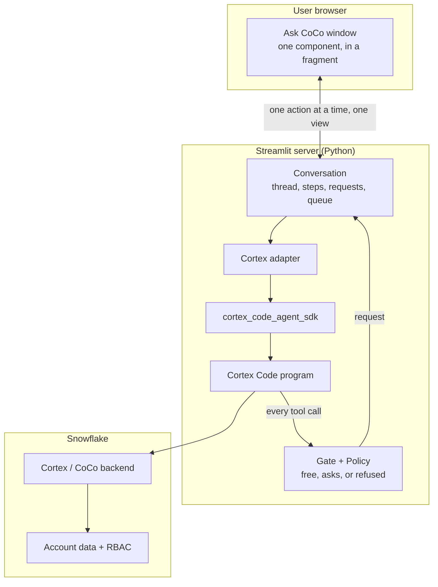

# PRD: streamlit-coco

**Product:** `streamlit-coco` — a Streamlit component and Python library for embedding [Snowflake CoCo](https://www.snowflake.com/en/product/snowflake-coco/) (formerly Cortex Code) in Streamlit applications.

**Author:** —  
**Status:** `0.2.1` published on 2026-10-20 (`0.2.0` with the asset contributor named in the README). The 0.1.9 chat family stays the default; Ask CoCo is opt-in. Next on the [roadmap](roadmap.md): API mode (no CLI) as `0.3.0`, then `0.3.5` / `0.4.0`.
**Last updated:** 2026-10-14

---

## 1. Executive summary

Data teams increasingly build internal tools in Streamlit, but Snowflake CoCo today is primarily consumed through CLI, Snowsight, Desktop, and IDE extensions. **`streamlit-coco` bridges that gap**: it wraps the [Cortex Code Agent SDK](https://docs.snowflake.com/en/user-guide/cortex-code-agent-sdk/cortex-code-agent-sdk) (`cortex_code_agent_sdk`) and exposes:

1. **A Python API** for programmatic, headless agent orchestration (`query()`, `CocoSession`).
2. **Ask CoCo**: a floating chat window opened from a launcher at the bottom right of the page, mounted with one call (`ask_coco(cwd)`). It shows the conversation, each tool call as a step, and every request for rights in plain words with the exact command, file text or SQL statement one click away. The host writes the rights as a policy; the default is the safest. `app_viewer()` previews a child Streamlit app beside it.
3. **A scripted agent** (`STREAMLIT_COCO_AGENT=mock`) that goes through the same policy and gate, to build and test with no Snowflake login.

Designed for Snowflake-native workflows: SQL generation, semantic view design, dbt/Airflow scaffolding, data profiling, and governed tool execution against a live Snowflake account.

---

## 2. Problem statement

### 2.1 User pain

| Persona | Pain today |
| --- | --- |
| **Streamlit app developer** | Must hand-roll subprocess/NDJSON parsing, async streaming, and permission UX to embed CoCo. |
| **Analytics engineer / data analyst** | Wants CoCo inside operational dashboards, not only in a separate terminal or Snowsight tab. |
| **Platform / governance owner** | Needs visible approval gates before destructive tools (Write, Bash, SQL DDL) run from a web UI. |

### 2.2 Why Streamlit specifically

- Streamlit is the de facto framework for Snowflake-adjacent internal apps (Cortex Analyst demos, FinOps dashboards, semantic layer explorers).
- Streamlit’s rerun model conflicts with long-running agent loops and blocking permission prompts — a dedicated component must reconcile **async agent I/O** with **synchronous script reruns**.
- Custom Components v2 (`st.components.v2`) provides bidirectional state/trigger channels ideal for chat UX and one-shot user responses.

### 2.3 Constraints from CoCo

- The SDK spawns the `cortex` CLI as a subprocess and communicates over **NDJSON on stdout**.
- Tool permissions are enforced via `allowed_tools`, `permission_mode`, and the async **`can_use_tool`** callback — the natural hook for UI confirmations.
- Multi-turn context requires a persistent **`CortexCodeSDKClient`** session; single-turn tasks use **`query()`**.
- CoCo must be installed and authenticated on the **runtime host** (Streamlit server), not in the end-user’s browser.

---

## 3. Goals and non-goals

### 3.1 Goals (v1)

| ID | Goal |
| --- | --- |
| G1 | Ship a pip-installable package `streamlit-coco` with a declarative Python API and a mountable Streamlit component. |
| G2 | Stream CoCo NDJSON messages to the UI in near real time (assistant text, tool calls, tool results, thinking, completion). |
| G3 | Support **human-in-the-loop** interactions: approve/deny tool use, provide extra context, answer clarifying questions, cancel/stop the agent. |
| G4 | Preserve **multi-turn conversation context** within a Streamlit session via `CortexCodeSDKClient`. |
| G5 | Integrate cleanly with **`st.session_state`**, Snowflake connections, and Streamlit theming (`--st-*` CSS variables). |
| G6 | Document deployment requirements (CLI, credentials, SPCS vs local server). |
| G7 | Isolate agent UI reruns with **`@st.fragment`** so the rest of the app does not rerun on every stream tick or chat interaction (the window is one component in a fragment). |

### 3.2 Non-goals (v1)

| ID | Non-goal | Rationale |
| --- | --- | --- |
| NG1 | Replace CoCo CLI / SDK or proxy LLM calls from the browser | Security and licensing; agent runs server-side only. |
| NG2 | Host CoCo as a managed SaaS | Out of scope; users bring their own Snowflake + CLI setup. |
| NG3 | Full IDE features (file tree, diff editor, multi-tab workspace) | CoCo Desktop / VS Code extension territory. |
| NG4 | TypeScript SDK parity | Python-first; TS consumers can use CoCo SDK directly. |
| NG5 | Slack / MCP server implementations | May come later; v1 focuses on Streamlit embedding. |
| NG6 | Remote agent proxy / sidecar HTTP service | Explicitly out of scope; CoCo CLI must run on the Streamlit server host. |
| NG7 | File upload into `cwd` from the browser | **`0.1.5`** — see [`features/ask-coco/ask-coco.md`](features/ask-coco/ask-coco.md) (`upload_to_cwd` / chat attachments). |

---

## 4. Target users and use cases

### 4.1 Personas

1. **App builder**: adds `st_coco.ask_coco(cwd)` to a Streamlit application and writes its policy.
2. **Operator**: answers the window's requests (Allow / Decline) for SQL or pipeline changes.
3. **Automation author** — uses headless `query()` / `CocoSession.send()` in jobs triggered from Streamlit.

### 4.2 Primary use cases

| UC | Description | API mode |
| --- | --- | --- |
| UC1 | **Embedded data copilot** — chat in a semantic view or dbt project explorer | `ask_coco()` |
| UC2 | **Guided pipeline builder** — agent proposes DDL/dbt models; user confirms each Write/Edit | `ask_coco(policy=...)` |
| UC3 | **One-shot task** — “Profile this table and return JSON” with structured output | `coco.query()` |
| UC4 | **Multi-step wizard** — app drives turns programmatically between Streamlit steps | `CocoSession.send()` / `run()` / `stream()` |
| UC5 | **Audit trail** — stream logged via `on_event` / `events_to_dataframe` | Python events (+ SDK hooks pass-through) |

---

## 5. Product architecture

### 5.1 High-level diagram



### 5.2 Package layout (as implemented)

```text
streamlit_coco/
├── window.py        # ask_coco(), get_window(), the handle
├── conversation.py  # the contract between the window and the agent
├── policy.py        # Policy, FolderPolicy, Command, git_readonly, request, inside
├── gate.py          # the decision that waits for Allow / Decline
├── features.py      # Features, Attachments
├── labels.py        # every sentence, by key
├── cortex.py        # the Cortex Code adapter
├── testing/         # scripted agent, fixtures, harness
├── static/          # the window's script, styles, font
├── session.py, query.py, options.py, permissions.py   # headless
├── viewer.py, app_preview.py                          # app_viewer
└── upload.py, uploader.py                             # uploads
examples/            # chat, approval gate, structured output, upload, headless, backlog desk, BI to Semantic, App Builder
```

### 5.3 Runtime model

Streamlit reruns the script top to bottom on every interaction. The agent loop is long-lived and async, so:

1. **`st.session_state`** holds one `Conversation` per window key and browser session.
2. **A background thread** runs the agent and reports plain events to the conversation.
3. **The window is one component inside a fragment.** An action or a poll reruns that fragment only, never the page. While CoCo works the component asks for the next view by itself; idle, nothing runs. A file change by the agent reruns the page once, after `on_files_changed`.
4. **Every tool call reaches the Gate**, which asks the policy: free, asks, or refused. A request waits for Allow or Decline in the window, and expires as a decline after ten minutes.

### 5.4 Fragment boundary (decision)

The window is mounted inside a fragment so streaming and polling never rerun the page. Page buttons that call `coco.ask` or `coco.form` rerun the page once, so they sit behind a button. See [`features/ask-coco/ask-coco.md`](features/ask-coco/ask-coco.md).

---

## 6. Functional requirements

### 6.1 Python public API

#### 6.1.1 Configuration — `CocoOptions`

Thin, documented wrapper over `CortexCodeAgentOptions`:

| Field | Type | Description |
| --- | --- | --- |
| `connection` | `str \| None` | Snowflake connection name (from `~/.snowflake/connections.toml`) |
| `cwd` | `str` | Working directory for file tools |
| `model` | `str \| None` | e.g. `claude-sonnet-4-6`, `claude-opus-4-6`, `auto` |
| `allowed_tools` | `list[str]` | Tools that may auto-run without a prompt (when approvals are configured, enforced in Python — not via CLI `--allowed-tools`) |
| `disallowed_tools` | `list[str]` | Tool blacklist |
| `permission_mode` | `str` | `default`, `acceptEdits`, `plan`, `bypassPermissions` |
| `profile` | `str \| None` | Named CoCo profile |
| `cli_path` | `str \| None` | Custom `cortex` binary path |
| `mcp_servers` | `dict` | MCP server map (passed through to SDK) |
| `hooks` | `dict` | SDK lifecycle hooks (pass-through) |
| `require_approval_for` | `list[str] \| Callable` | Tools that always pause for UI approval |
| `output_schema` | `dict \| None` | JSON Schema → SDK `output_format` structured output |
| `max_turns` | `int \| None` | Max agentic turns |
| `approval_timeout_seconds` | `float` | Pending approval wait (default 600) |
| `extra_sdk_options` | `dict` | Escape hatch for additional `CortexCodeAgentOptions` fields |

#### 6.1.2 Headless single-turn — `coco.query()`

```python
import streamlit_coco as coco

async for event in coco.query("Summarise ANALYTICS.CUSTOMERS", options=opts):
    if event.type == "assistant_text":
        ...
    elif event.type == "result":
        break
```

**Requirements:**

- Wraps SDK `query()`; yields normalized **`CocoEvent`** objects (see §6.2).
- Supports `output_schema: dict` for structured JSON results on `result.structured_output`.
- Typed exception hierarchy: `streamlit_coco.errors` (+ `require_environment()`).

#### 6.1.3 Multi-turn session — `CocoSession`

```python
session = coco.CocoSession(options=opts, key="coco_main")
session.send("Read the schema for ANALYTICS")  # queues on background worker
# The window runs its own session; scripts use stream() / run() or a Conversation
# Headless: async for event in session.stream("…"): …  /  await session.run("…")
session.cancel()
session.reset()
session.close()
```

**Requirements / status:**

- Wraps `CortexCodeSDKClient` on a background thread + asyncio loop.
- **`key`** registers the session in an in-process registry (`get_session(key)`).
- Methods: `send(prompt)`, `run(prompt)`, `stream(prompt)`, `cancel()`, `close()`, `reset()`, `sync_options()`, `execute_plan()`, `set_permission_mode()`.
- Properties: `is_running`, `needs_polling`, `messages` / transcript, `last_result`, `status`.
- The window does not use `CocoSession`; headless scripts use `stream()` / `run()` without loading Streamlit.

#### 6.1.4 Streamlit UI: `ask_coco`

```python
import streamlit as st
import streamlit_coco as st_coco

coco = st_coco.ask_coco(".")
if st.button("Summarise this folder"):
    coco.ask("Summarise this folder", "Read the files here and say what they are for.", key="sum")
```

**Requirements:**

| ID | Requirement | Status |
| --- | --- | --- |
| FR-W1 | One call mounts the launcher and the window; the page does not rerun while CoCo works | ✅ |
| FR-W2 | Reading inside the working folder is free; every other call asks, each time (the default policy) | ✅ |
| FR-W3 | A request shows what it is about and the exact command, file text or SQL statement; Allow or Decline | ✅ |
| FR-W4 | A standing permission, only when the policy offers it (`standing=True`) | ✅ |
| FR-W5 | Stop; type ahead while CoCo works (queued, can be taken back) | ✅ |
| FR-W6 | Questions and plans from CoCo wait for the user; planning only through "Plan first" | ✅ |
| FR-W7 | The page asks CoCo in the user's name (`coco.ask`), reads the result (`coco.result`), asks a form (`coco.form`) | ✅ |
| FR-W8 | Files attached in the field are saved in the working folder (`Features(attachments=...)`) | ✅ |
| FR-W9 | Every sentence is a label key; theme by CSS variables | ✅ |
| FR-W10 | A scripted agent runs any application with no login | ✅ |
| FR-W11 | `app_viewer()`: child Streamlit process, iframe, Fix with CoCo through `on_fix` | ✅ `0.1.7` |

#### 6.1.5 The chat family stays

`chat`, `panel`, `copilot_rail` and their helpers stay the default UI in `0.2.0`. The floating window is off until `mini=True` or `ask_coco(cwd)`. Decisions: [`features/ask-coco/ask-coco.md`](features/ask-coco/ask-coco.md).

#### 6.1.6 Imperative helpers

| Function | Purpose | Status |
| --- | --- | --- |
| `coco.get_session(key)` | Retrieve a `CocoSession` from the registry | ✅ |
| `session.permission_manager.resolve(...)` | Answer a `CocoSession`'s own approval | ✅ |
| `conv.act({"type": "allow" \| "decline", "id": ...})` | Answer a window request in code | ✅ |
| `coco.get_window(key)` | The window's handle, anywhere on the page | ✅ |
| `coco.events_to_dataframe(events)` | Flatten events for audit views | ✅ |

---

### 6.2 Event model — `CocoEvent`

Normalized events abstract SDK / NDJSON message types:

| `event.type` | Source SDK type | Payload highlights |
| --- | --- | --- |
| `system` | `SystemMessage` | Init metadata |
| `assistant_text` | `AssistantMessage` → `TextBlock` | `text`, `delta` |
| `thinking` | `ThinkingBlock` | `text` (hidden by default in UI) |
| `tool_use` | `ToolUseBlock` | `name`, `input`, `id` |
| `tool_result` | `ToolResultBlock` | `tool_use_id`, `content`, `is_error` |
| `stream_event` | `StreamEvent` | Partial deltas |
| `permission_request` | `can_use_tool` / `PermissionRequest` hook | `request_id`, `tool_name`, `tool_input` |
| `result` | `ResultMessage` | `subtype`, `duration_ms`, `structured_output`, `cost_usd` |
| `error` | exceptions / `result.subtype` errors | `message`, `code` |

All events are JSON-serializable for component `data` and logging.

---

### 6.3 Human-in-the-loop flows

#### 6.3.1 Tool request (primary)

Every tool call reaches the Gate before it runs. The policy answers: free, asks, or refused (only for a call the app cannot read). A request waits in the window; the user presses Allow or Decline.

**Requirements:**

- The request is written by the application from the checked call, never from the agent's description.
- An unanswered request expires after ten minutes as a decline. The first answer stands.
- After Allow the call is judged again and must still be what was shown.
- Decline tells the agent it was declined. A standing permission (`standing=True`) lasts until the conversation ends and never covers `.git`, a secret-named file or a flagged place.

#### 6.3.2 Questions and forms

- A question from CoCo (AskUserQuestion) is shown as a block in the window. It has no switch and no standing permission.
- `coco.form(title, fields, key=...)` is a form the application asks, answered in the window, with no agent.

#### 6.3.3 Plan mode

`Features(planning=True)` adds "Plan first" to the menu. A plan from CoCo (ExitPlanMode) waits for **Approve plan** or a decline with a reason. After approval each change still asks.

---

### 6.4 Streaming UX requirements

| ID | Requirement | Priority | Status |
| --- | --- | --- | --- |
| FR-S1 | Assistant text appends in place without flicker (stable keys / fragment polling) | P0 | ✅ |
| FR-S2 | Auto-scroll to bottom while running; pause auto-scroll if user scrolls up | P1 | ⏳ Later — [`roadmap`](roadmap.md) |
| FR-S3 | Tool activity visible without hunting; errors prominent | P1 | ✅ **Superseded** — compact meaningful expanders (label always visible; body collapsed); auto-open on error ([`tools-display/SPEC`](features/ask-coco/ask-coco.md)); debug **Raw tool payload** nested collapsed |
| FR-S4 | Stop button sends SDK cancel/interrupt; UI marks run as `cancelled` | P0 | ✅ |
| FR-S5 | Show spinner / pulsing indicator during tool execution | P1 | ✅ progress captions while `running`; cleared on complete/error |
| FR-S6 | Render code blocks and SQL with syntax highlighting | P1 | ✅ `0.1.5` — fenced markdown → `st.code`; SQL/bash cards highlighted |
| FR-S7 | Copy-to-clipboard on assistant messages and tool results | P2 | ✅ `0.1.5` — `show_copy=` (default on) |

---

### 6.5 Session and state management

| ID | Requirement | Status |
| --- | --- | --- |
| FR-ST1 | Session keyed in registry / `st.session_state`; transcript, pending approval, status on `CocoSession` | ✅ |
| FR-ST2 | Changing `options` mid-session calls `session.reset()` or warns user (configurable) | ⚠️ partial (`sync_options` / reset available; no forced warn UX) |
| FR-ST3 | `reset()` clears transcript and closes SDK client | ✅ |
| FR-ST4 | Transcript persists across reruns; optional `max_messages` truncation + “load earlier”; optional `preview_chars` | ✅ persistence; ✅ truncation/`Load earlier` in `0.1.5`; ✅ `preview_chars` in `0.1.6` |
| FR-ST5 | Multiple independent sessions via distinct `key` values on same page | ✅ |

---

### 6.6 Structured output rendering (decision)

When `CocoOptions(output_schema=...)` is set, the turn's answer is data. The window shows it as a data block (fields, tables, JSON). The page reads it with `coco.result(key)["data"]` after `coco.ask(label, text, key=key)`. Headless `query()` and `CocoSession` expose `structured_output` on the `result` event.

---

## 7. Non-functional requirements

| Category | Requirement |
| --- | --- |
| **Performance** | First token visible ≤ 2s after prompt submit on warm session (network-dependent). UI rerender ≤ 100ms for incremental deltas batched at 50–100ms. |
| **Compatibility** | Python 3.10+; Streamlit ≥ 1.55 (Custom Components v2 + `@st.fragment`); `cortex-code-agent-sdk` version pinned in extras. |
| **Rerun scope** | Chat interactions and stream polling do not rerun the page: the window is one component in a fragment. |
| **Security** | No Snowflake credentials in frontend `data`; tool inputs sanitized in markdown; CSP-safe component (no inline eval). |
| **Accessibility** | Keyboard submit (⌘/Ctrl+Enter); focus trap in approval modal; ARIA labels on actions. |
| **Observability** | Optional `on_event` callback for structured logging; hooks forwarded to SDK. |
| **Packaging** | Wheel includes static frontend assets; `pip install streamlit-coco[sdk]`. Dual-repo publish ready; first PyPI tag pending ([`deployment/publish.md`](deployment/publish.md)). |

---

## 8. Deployment and prerequisites

### 8.1 Server-side requirements

Document prominently in README:

1. **CoCo CLI** installed and on `PATH` (`cortex --version`).
2. **Authenticated Snowflake connection** in connections.toml or env vars.
3. Streamlit app runs on a host **allowed to spawn subprocesses** (local, VM, SPCS container — not typical browser-only Streamlit Cloud unless CLI pre-installed).
4. **`cortex-code-agent-sdk`** Python package.

### 8.2 Deployment topologies

| Topology | Support | Notes |
| --- | --- | --- |
| Local CLI (`streamlit run` + `cortex`) | ✅ Primary today | CLI on same machine |
| Local API (`streamlit run`, no CLI) | ⏳ Next | `mode="api"` + Snowflake Sandbox |
| Streamlit in Snowflake | ⏳ `0.3.5` | API mode; current-user session (no CLI) |
| Native App | ⏳ `0.4.0` | API mode inside a Snowflake Native App |
| Snowpark Container Services | ⏳ Later | Agent on staged files — [roadmap](roadmap.md) |
| Streamlit Community Cloud | ⚠️ Limited | Only if CLI + secrets available on the host; no remote-proxy workaround planned |

---

## 9. API sketch (as implemented)

The full list, with signatures, is [`api.md`](api.md).

```python
import streamlit as st
import streamlit_coco as st_coco
from streamlit_coco import policy

coco = st_coco.ask_coco(
    ".",
    policy=policy.FolderPolicy(".", changes="*.md", sql=True),
    features=st_coco.Features(planning=True),
)
```

Headless: `query()`, `CocoSession`, and `streamlit_coco.conversation.Conversation` with a policy.

## 10. UX (logical)

A launcher at the bottom right of the page. It opens a window: a header (title, menu, minimise), the conversation thread (your messages, CoCo's answers, steps folded under the sentence that introduced them), and a field with Send, which becomes Stop while CoCo works. A request replaces the field's footer with what it is about, the exact text one click away, and Allow and Decline. The closed launcher shows an arc while CoCo works and a pill when something waits ("Allow a read?"). The design sheet (86 frames) is the reference; [`features/ask-coco/ask-coco.md`](features/ask-coco/ask-coco.md) lists every decision.

---

## 11. Milestones

### Phase 0 — Foundation

- [x] Repo scaffold, pyproject
- [x] `CocoEvent` parser from NDJSON / SDK messages
- [x] `CocoSession` wrapping `CortexCodeSDKClient`
- [x] Unit tests (inline fixtures)
- [x] CI workflow
- [x] Recorded NDJSON fixture corpus

### Phase 1 — Headless API

- [x] `query()` async generator
- [x] `CocoOptions` (+ `output_schema`, `extra_sdk_options`, …)
- [x] Example: headless pipeline script
- [x] Typed error hierarchy
- [x] `CocoSession.stream()` / `run()` async API

### Phase 2 — Component / UI MVP

- [x] CCv2 component registration + **static** frontend assets (Vite build deferred → Later)
- [x] Native `panel()` + `send_prompt()` (preferred path)
- [x] `@st.fragment` wrapper (`use_fragment=True` default)
- [x] Transcript rendering + prompt input + cancel
- [x] Streaming assistant text
- [x] Tool call cards (meaningful cards — see tools-display SPEC)
- [x] Inline structured output panel (default)

### Phase 3 — Human-in-the-loop

- [x] `can_use_tool` ↔ approval UI
- [x] `approve_pending` / `deny_pending`
- [x] `on_structured_output` + `structured_output_container`
- [x] Example: approval gate app
- [x] Plan mode **Execute** CTA
- [x] App-owned `request_input` (+ AskUserQuestion HITL)
- [x] Edit/Write unified diff preview on approvals (native path)
- [x] Pluggable text renderer (`text_renderer=`)

### Phase 4 — Polish & release

- [x] README + Makefile + GitHub repos (`streamlit-coco-dev` + public `streamlit-coco`)
- [ ] Theming / a11y pass (keyboard traps, ARIA) — Later / FR-S2
- [x] PyPI publish `0.1.0` (2026-08-06); follow-ups `0.1.5`, `0.1.6`, `0.1.7`, `0.1.8`, `0.1.8.1`, `0.1.9`
- [x] Native `copilot_rail()` + Tableau → Semantic example (`0.1.6`); **`app_viewer()`** + **BI → Semantic** Power BI (`0.1.7`); **App Builder** (`0.1.8`); **`deferred=`** rail starters (`0.1.8.1`); Config file picker (`0.1.9`)
- [ ] Deployment docs beyond local (Docker, SPCS)

**Current:** Alpha `0.1.9`; Phase 3 complete; Phase 4 polish continues. Living plan: [`roadmap.md`](roadmap.md).

---

## 12. Success metrics

| Metric | Target (90 days post-launch) |
| --- | --- |
| PyPI downloads | 500+ |
| GitHub stars | 50+ |
| Median time-to-first-working-app | < 30 min following quickstart |
| Issue: “streaming broken on rerun” | 0 open P0 past 30 days |
| Community examples | ≥ 3 contributed sample apps |

---

## 13. Risks and mitigations

| Risk | Impact | Mitigation |
| --- | --- | --- |
| Streamlit rerun races with async agent | Broken streams, duplicate clients | Single bridge per session; idempotent mount; mutex on client lifecycle |
| CoCo CLI not on Streamlit Cloud | Blocks hosted demos | Document SPCS/local deployment; no remote proxy planned |
| SDK / NDJSON schema changes | Parser breaks | Pin SDK version; fixture tests; tolerant parsing |
| Long approval waits block worker | Timeouts | Configurable timeout; deny with message; session cancel |
| Sensitive data in tool inputs shown in UI | Compliance | Each request shows the exact input, one click away; `Features(steps=False)` hides the cards |

---

## 14. Product decisions (resolved)

| # | Question | Decision |
| --- | --- | --- |
| 14.1 | Remote agent proxy (sidecar HTTP service for Streamlit Cloud)? | **No.** CoCo CLI runs on the Streamlit server host only; no proxy layer. |
| 14.2 | Structured output UX? | **A data block in the window.** The page reads it with `coco.result(key)` (see §6.6). |
| 14.3 | File upload into `cwd`? | **`0.1.5`** — [`features/ask-coco/ask-coco.md`](features/ask-coco/ask-coco.md). |
| 14.4 | Branding? | **“CoCo”** in all user-facing UI copy. |
| 14.5 | Async Streamlit / fragments? | **Yes.** The window is one component in a fragment. |
| 14.6 | Primary Streamlit UX? | **The 0.1.9 chat family stays the default.** Ask CoCo is opt-in (`ask_coco` or `mini=True`). |
| 14.7 | Frontend build? | **Static** js/css under `streamlit_coco/static/` (no build step); Vite/`asset_dir` packaging is **Later** on the roadmap (optional). |

---

## 15. References

- [Snowflake CoCo product page](https://www.snowflake.com/en/product/snowflake-coco/)
- [Cortex Code Agent SDK deep dive (Snowflake Builders Blog)](https://medium.com/snowflake/building-programmable-ai-agents-on-snowflake-a-deep-dive-into-the-cortex-code-agent-sdk-811be94b004e)
- [Streamlit Custom Components v2 — registration & bidirectional communication](https://docs.streamlit.io/develop/concepts/custom-components/components-v2/register)
- [Streamlit CCv2 state vs triggers](https://docs.streamlit.io/develop/concepts/custom-components/components-v2/state-and-triggers)
- Package: `cortex-code-agent-sdk` (`CortexCodeSDKClient`, `query`, `CortexCodeAgentOptions`, `can_use_tool`)
- [Cortex Code Agent SDK docs](https://docs.snowflake.com/en/user-guide/cortex-code-agent-sdk/cortex-code-agent-sdk)
- Repo (public): https://github.com/DevoteamSP/streamlit-coco
- Repo (dev): https://github.com/DevoteamSP/streamlit-coco-dev
- Publish: [`doc/deployment/publish.md`](deployment/publish.md)

---

## Appendix A — SDK message mapping

| Raw NDJSON `type` | Block `type` | `CocoEvent.type` |
| --- | --- | --- |
| `assistant` | `text` | `assistant_text` |
| `assistant` | `thinking` | `thinking` |
| `assistant` | `tool_use` | `tool_use` |
| `assistant` | `tool_result` | `tool_result` |
| `result` | — | `result` |
| `stream_event` | — | `stream_event` |
| (hook) | — | `permission_request` |
